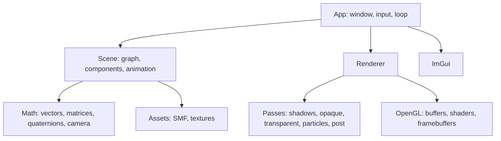

```markdown
# Cozy Room Diorama

**A cozy room diorama — final project for the Computer Graphics Fundamentals course (C++).**

A cutaway room diorama: a warm lamp, rain outside the window, fairy lights, a
sleeping cat and steam over a mug. Everything is rendered by a custom OpenGL 3.3
Core renderer, with no game engines.

**Stack:** C++17, OpenGL 3.3 Core, Win32/WGL, CMake, Dear ImGui, doctest, GitHub Actions.
**Goal:** 60 FPS at 1080p and a finished result.

## Quick start

```bash
# MinGW (Ninja)
cmake --preset mingw
cmake --build --preset mingw
./build/mingw/cozy_room.exe

# MSVC (Visual Studio 2022)
cmake --preset msvc
cmake --build --preset msvc
```

Or just run `scripts/build_mingw.bat` — it sets the MSYS2 PATH automatically.

---

## What's in the scene

- A 6×6×4 m diorama: floor, two walls and a window; the open side faces the camera.
- Bed, desk, monitor, bookshelf, plant, mug, rug, posters.
- A desk lamp with warm point light, cold light from the window, fairy lights.
- Animation: the cat breathing, curtains swaying, lamp flicker, steam, rain, dust.
- Modes: orbit, free camera, cinematic flythrough, debug.

## Tech stack

| Layer | Technology |
|---|---|
| Language | C++17 |
| Graphics | OpenGL 3.3 Core |
| Window | Win32 + WGL (from the labs) |
| Math | custom `math3d` (vectors, matrices, quaternions) |
| Assets | custom SMF loader + `stb_image` |
| UI | Dear ImGui |
| Build | CMake 3.20+ (MSVC and MinGW) |
| Tests | doctest |
| CI | GitHub Actions, windows-latest |

## Architecture



Rules: `core/` knows nothing about OpenGL, `gfx/` hides every `gl*` call,
`scene/` stores data, `render/` builds the render list, `app/` wires everything together.


## Requirements

**Must have:** one-command build, scene graph, orbit and free camera, SMF and
texture loading, Blinn–Phong lighting (directional, point, spot), shadows,
transparency, HDR and tone mapping, five or more animated objects, ImGui UI,
screenshot, benchmark, README, report, video.

**Should have:** bloom, normal mapping, particles, frustum culling, batching,
instancing, cinematic camera, lighting presets, golden-image tests, CI.

**Nice to have:** SSAO, physically based rendering (PBR), screen-space
reflections (SSR), volumetric light shafts, depth of field, JSON scene loading,
hot shader reload.

Rule: must-haves first, then should-haves, the rest only if there is time left.

## Definition of done

- [ ] A clean clone builds with one command (MSVC and MinGW).
- [ ] All must-have and most should-have features work.
- [ ] 60 FPS at 1080p, confirmed by the benchmark.
- [ ] Tests and CI are green, build has no warnings.
- [ ] The README gets the project running in 5 minutes.
- [ ] Report, video, screenshots and slides are ready.
- [ ] `v1.0.0` release is published.

## Controls

| Action | Key |
|---|---|
| Rotate / pan / zoom | LMB / MMB / mouse wheel |
| Movement (free camera) | WASD, Q/E, Shift |
| Orbit / free camera | Tab |
| Cinematic flythrough | C |
| Wireframe / bounds / shadow map | F1 / F2 / F3 |
| Bloom | F4 |
| Screenshot | F12 |
| ImGui panel | F5 |

## Status

| Stage | Status |
|---|---|
| Planning and README | ✅ Done |
| Project skeleton | 🟡 In progress |
| Weeks 2–10 | ⬜ Not started |

## License

Code is licensed under MIT. Assets are CC0 or original only
(see `assets/CREDITS.md`).
```

Если нужно — могу этой же версией заменить README в репозитории.
